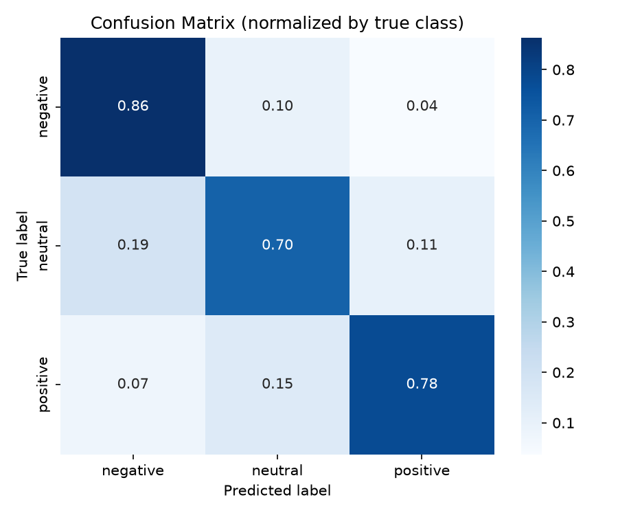
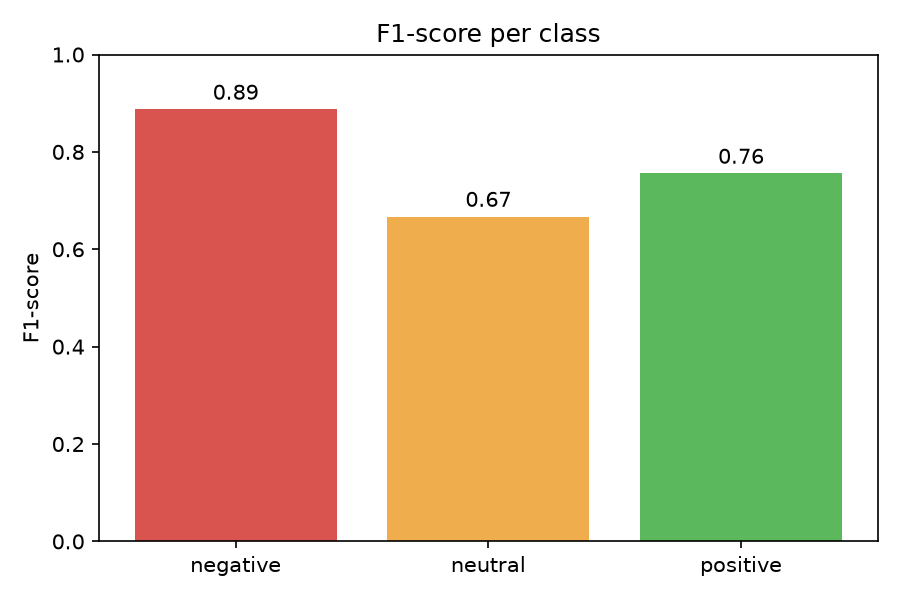

# Multi-Class Sentiment Classifier for Airline Tweets

A Python NLP pipeline that classifies tweets as **negative**, **neutral** or **positive**.
Built for the Progree AI internship (Task 2).

## Requirements covered

| Requirement | Where |
|---|---|
| Python + Scikit-Learn | whole project |
| Stop-word removal | `src/preprocess.py` |
| Lemmatization | `src/preprocess.py` |
| TF-IDF features (+ text embeddings) | `src/train.py`, `src/train_final.py` |
| Evaluation with F1-score | `src/evaluate.py`, `src/train_final.py` |

## Dataset

[Twitter US Airline Sentiment](https://www.kaggle.com/datasets/crowdflower/twitter-airline-sentiment) (Kaggle): 14,640 tweets labelled negative (62.7%), neutral (21.2%) or positive (16.1%).
The classes are **imbalanced**, so the main metric is **macro F1**, which weights all classes equally. Accuracy alone would reward a model that mostly predicts "negative".

After preprocessing, 22 tweets became empty (for example, only a URL and a mention) and were dropped, leaving 14,618 tweets: 11,694 for training and 2,924 for testing (stratified 80/20 split, `random_state=42`).

## Pipeline

1. **Preprocessing** (`preprocess.py`): lowercase, expand contractions, remove URLs, @mentions and non-letters, remove stop-words, lemmatize with WordNet. Negations (`no`, `nor`, `not`, ...) are deliberately kept, because removing them flips sentiment ("not good" would become "good").
2. **Features**: word TF-IDF (1-2 grams), character TF-IDF (2-5 grams) and sentence embeddings (`all-MiniLM-L6-v2`, computed on the tweet with only URLs and mentions removed).
3. **Model**: Logistic Regression with `class_weight="balanced"`.
4. **Model selection**: 5-fold stratified cross-validation on the training set only. The test set was used for reporting, not for choosing the model.

## Results

Cross-validated macro F1 (training set, 5-fold):

| Experiment | CV macro F1 |
|---|---|
| TF-IDF + LinearSVC | 0.717 |
| TF-IDF + Logistic Regression (baseline) | 0.725 |
| Baseline with tuned hyperparameters | 0.729 |
| Word + character TF-IDF | 0.736 |
| Sentence embeddings + Logistic Regression | 0.748 |
| **Word + char TF-IDF + embeddings (final)** | **0.777** |

Held-out test set (evaluated once, after model selection):

| Model | Accuracy | Macro F1 |
|---|---|---|
| TF-IDF baseline | 0.776 | 0.726 |
| Embeddings only | 0.773 | 0.729 |
| **Final model** | **0.816** | **0.770** |

Final model, per class:

| Class | Precision | Recall | F1 |
|---|---|---|---|
| negative | 0.912 | 0.864 | 0.887 |
| neutral | 0.635 | 0.703 | 0.667 |
| positive | 0.733 | 0.780 | 0.756 |

Combining the three feature types gives about +4.4 macro F1 points over the baseline on the test set. Embeddings alone are statistically tied with the baseline on the test set.

Scores can differ in the third decimal depending on library versions; the versions used are pinned in `requirements.txt`.




## Error analysis

- 56% of the baseline's errors were negative/neutral confusions. Complaints without strong emotional words (for example, a rebooking problem described neutrally) look neutral to a bag-of-words model.
- Some labels look noisy or ambiguous, which limits any model's ceiling on this dataset.
- Combining word, character and embedding features helped every class, most of all neutral (F1 0.612 to 0.667), but neutral remains the weakest class.

## How to run

```bash
git clone <your-repo-url>
cd <repo-folder>
python -m venv venv
venv\Scripts\activate          # Windows (Mac/Linux: source venv/bin/activate)
pip install -r requirements.txt
```

Download `Tweets.csv` from Kaggle into `data/`, then run in this order:

```bash
python src/train.py              # baseline, creates the train/test split
python src/train_embeddings.py   # computes embeddings (a few minutes on CPU)
python src/train_final.py        # trains and evaluates the final model
python src/predict.py "My flight was cancelled and nobody helped me"
```

Optional scripts: `explore.py` (data overview), `evaluate.py` (baseline evaluation), `error_analysis.py`, `tune.py`, `experiments.py`, `experiments_combined.py`.

## Limitations

- Tweet-specific noise (abbreviations, typos, hashtags glued together) is only partly handled.
- WordNet lemmatization assumes every word is a noun, which misses verb forms such as "delayed".
- Predicted probabilities are not calibrated.
- Trained on airline tweets only, so performance on other domains is not guaranteed.

## Possible next steps

Fine-tune a transformer (for example DistilBERT), use part-of-speech-aware lemmatization, and keep `?`/`!` as features.